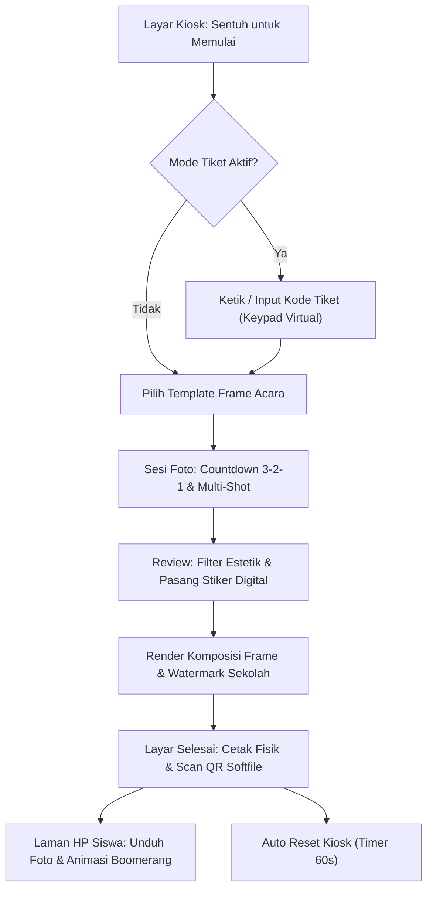

# Product Requirements Document (PRD)
## Aplikasi Photobooth Sekolah (Inspirasi: Funcam.id)
### Architecture: Go + Gin + GORM + SQLite (Pure-Go) + Meridian Admin Template

---

## 1. Ringkasan Eksekutif & Latar Belakang
Aplikasi Photobooth Sekolah adalah sistem photobooth modern, berdesain bersih (*clean minimalism*), sangat ringan, dan mudah dioperasikan secara mandiri (*self-service kiosk*) maupun dengan operator/panitia. Terinspirasi oleh [Funcam.id](https://funcam.id/id), aplikasi ini disesuaikan untuk kebutuhan event sekolah (Pentas Seni, Bazar, Wisuda/Kelulusan, Class Meeting, Open House, dan event OSIS).

Aplikasi dibangun di atas pondasi arsitektur **Mastergin**:
- **Backend:** Go (Golang) + **Gin** framework + **GORM**
- **Database:** **SQLite Pure-Go** (`github.com/glebarez/sqlite`) — 100% tanpa CGO/GCC di Windows, stabil, cepat dengan mode WAL (*Write-Ahead Logging*).
- **Admin & Operator Panel:** **Meridian Dashboard** (`template/meridian/`) yang elegan, modern, dan fungsional.
- **Kiosk Frontend:** Standalone Fullscreen View bergaya *clean minimalism* dengan interaksi sentuh intuitif, WebRTC camera capture, client-side Canvas compositing, stiker digital, dan QR softfile offline lokal.

---

## 2. Profil Pengguna & Lingkungan Operasional
1. **Siswa & Pengunjung (End-User):**
   - Pengalaman foto mandiri yang seru, cepat, dan intuitif tanpa instruksi rumit.
   - Hasil foto beresolusi tinggi, filter estetik (*Korean 4-cut / 2-strip classic*), stiker digital drag-and-drop, serta akses instan ke softfile via scan QR Code.
   - Fitur **Boomerang Loop** di smartphone untuk posting ke Instagram Story / TikTok.
2. **Panitia / Operator OSIS / Guru (Booth Operator):**
   - Panel admin (Meridian) untuk mengunggah template frame baru dengan **bantuan preset koordinat**.
   - Sistem **Tiket & Voucher** untuk acara berbayar (bazar / pentas seni OSIS).
   - Ekspor seluruh dokumentasi foto acara dalam 1-klik ZIP.
   - Fitur penggantian kamera instan (*Camera Switcher*) di layar booth.
3. **Hardware Kiosk:**
   - Laptop / Mini PC Windows + Layar Sentuh Touchscreen (atau mouse).
   - USB Webcam Full HD (Logitech atau setara) / DSLR via capture card.
   - Printer foto (Canon SELPHY, Epson L-series, DNP, atau thermal printer).

---

## 3. Alur Pengalaman Pengguna (User Journey)

---

## 4. Struktur Modul Aplikasi

| Modul | Deskripsi | Rute Utama |
|---|---|---|
| **`modules/auth`** | Autentikasi operator (Login, Logout, JWT HTTP-only cookie) | `/login`, `/logout` |
| **`modules/kiosk`** | Antarmuka layar sentuh photobooth (Fullscreen, WebRTC, Countdown, Stiker, Offline QR) | `/kiosk` (atau `/`), `/api/qr` |
| **`modules/frames`** | Manajemen bingkai (Upload PNG transparan, auto-preset koordinat slot) | `/admin/frames`, `/api/frames` |
| **`modules/sessions`**| Riwayat pemotretan, reprint, ekspor ZIP dokumentasi, download softfile HP & Boomerang | `/admin/sessions`, `/admin/sessions/export-zip`, `/d/:code` |
| **`modules/vouchers`**| Manajemen tiket/voucher kupon bazar (generate batch, print lembar kupon, validasi) | `/admin/vouchers`, `/api/vouchers/validate` |
| **`modules/settings`**| Pengaturan kiosk (Nama acara, countdown, konfigurasi printer, IP lokal, mode tiket) | `/admin/settings`, `/api/settings` |

---

## 5. Kebutuhan Non-Fungsional (Non-Functional Requirements)

- **100% Offline-Capable:** QR code digenerate secara native di biner Go (`/api/qr`), bekerja di router/tethering lokal tanpa internet luar.
- **Ringan & Cepat:** Konsumsi RAM < 60 MB saat standby, respon UI instan.
- **Desain Clean Minimalism:** Tipografi jelas, kontras tinggi, tombol aksi besar untuk touchscreen, bebas distraksi.
